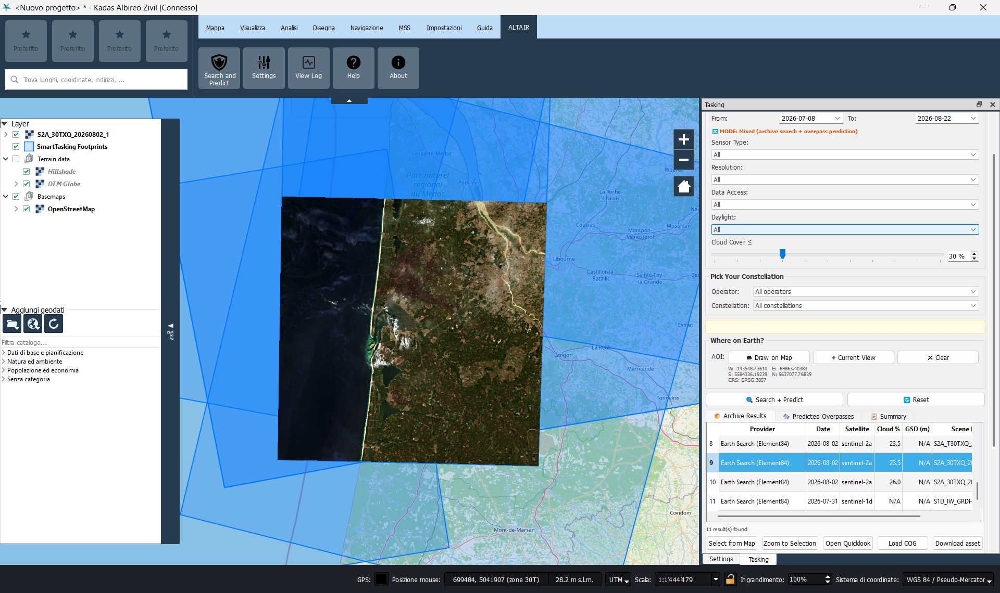
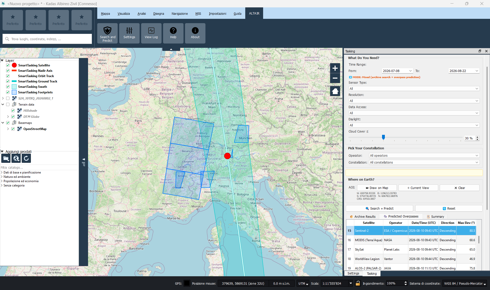

# KADAS Altaír — Satellite Imagery Browser Plugin

**Multi-source satellite imagery browser for KADAS Albireo 2**

[KADAS Albireo 2](https://www.kadas-albireo.ch) is an open-source GIS platform for geospatial planning, analysis and sharing. It is used to visualise maps and satellite data, manage operational scenarios and support rapid decision-making in the defense and security sectors.

[](LICENSE)
[](https://github.com/mlanini/kadas-altair-plugin)
[](https://github.com/mlanini/kadas-altair-plugin)
[](https://deepwiki.com/mlanini/kadas-altair-plugin)

## Screenshots


*Archive Search panel with search results and footprint selection.*


*Smart overpass prediction with orbit and footprint visualization.*

---

## Documentation

| Document | Contents |
|----------|----------|
| **[README.md](README.md)** | Overview, features, quick start (this file) |
| **[GUIDE.md](GUIDE.md)** | Installation, configuration, usage tutorial |
| **[CHANGELOG.md](CHANGELOG.md)** | Version-by-version change log |
| **[RELEASE_NOTES.md](RELEASE_NOTES.md)** | Curated release highlights |

---

## Quick Start

### Installation

1. Download the packaged plugin archive from the GitHub release page.
2. Extract it and place the plugin folder in the KADAS Python plugins directory.
3. Restart KADAS and enable the plugin from the Plugins Manager.

Example for Windows:

```powershell
Copy-Item -Recurse kadas_altair_plugin "$env:APPDATA\Kadas\KadasZivil\profiles\default\python\plugins"
```

Example for Linux / macOS:

```bash
cp -r kadas_altair_plugin ~/.local/share/Kadas/KadasZivil/profiles/default/python/plugins/
```

> Make sure the plugin folder is named `kadas_altair_plugin`. The plugin is designed for KADAS Albireo 2.3+ and works best with an active internet connection.

### First Use

1. Open KADAS and enable **KADAS Altair** from the Plugins Manager.
2. Start a **new** KADAS 'World (online)' project (EPSG:3857).
3. Open the **Search and Predict** panel from the **ALTAIR** menu.
4. Define an AOI by drawing on the map or using the current view.
5. Set date range, cloud-cover limits and optionally a collection.
6. Click **Search** to retrieve results.
7. In **Search and Predict**, a visible hourglass indicator confirms archive/overpass background processing is active.
8. Select a result and use **Preview** or **Load COG** to inspect or stream the scene.

### Optional Credentials

Some providers require authentication or tokens:
- **NASA EarthData**: token or username/password
- **Jilin-1 Gaofen**: bearer token
- **Commercial providers**: credentials configured in the plugin settings

Public connectors such as **Earth Search (Element84)**, **Microsoft Planetary Computer**, **JAXA Earth**, and **swisstopo** can be used without signing in. Other providers may require credentials. OneAtlas currently supports an OAuth connection test only and is not available for archive search.

---

## Features

### Connectors

The archive currently registers 12 connectors:

| # | Connector | Type | Notes |
|---|-----------|------|-------|
| 1 | **ICEYE SAR** | Radar | Open-data SAR search with STAC access |
| 2 | **Umbra SAR** | Radar | High-resolution SAR imagery and STAC support |
| 3 | **Capella SAR** | Radar | X-band SAR archive access |
| 4 | **Vantor Open Data** | Optical | Disaster-event imagery and open-data access |
| 5 | **swisstopo STAC** | Optical | swissEO S2-SR v200 by default, plus Special flights |
| 6 | **JAXA Earth STAC** | Multi | Public COG-STAC catalog with no credentials required |
| 7 | **Earth Search (Element84)** | Multi | Public STAC access for Sentinel and Landsat collections |
| 8 | **Microsoft Planetary Computer** | Multi | Public STAC access for curated optical and fire collections |
| 9 | **Jilin-1 Gaofen** | Optical | Commercial STAC connector with bearer-token support |
| 10 | **NASA EarthData** | Multi | Experimental connector for CMR/earthdata workflows |
| 11 | **Planet** | Optical | Data API and Tasking API; credentials required |
| 12 | **Custom STAC** | Multi | User-configured STAC endpoint with optional authentication |

OneAtlas OAuth settings remain available for credential testing, but OneAtlas is not registered as an archive provider because search is not implemented.

### Search and Visualization

- **Unified search** across spatial, temporal and cloud-cover dimensions
- **All Sources mode** to query multiple connectors in parallel
- **Interactive footprints** with map/table synchronisation
- **Quicklook preview** for rapid scene inspection
- **COG loading** via GDAL/virtual file access for streaming without full download
- **Collection-aware search** and metadata normalization for consistent results

### Search and Predict

- **Satellite catalogue** covering a broad set of EO and SAR constellations
- **SGP4 overpass prediction** for the center of the AOI bounding rectangle; this does not imply coverage of the full AOI or guarantee an acquisition
- **Configurable prediction window** with a 48-hour default and optional date-range mode
- **Validated orbital data** with persistent TLE cache, offline mode, a configurable maximum TLE age (72 hours by default), and no synthetic fallback times
- **Optical daylight filtering** with a configurable minimum solar elevation (10° by default); SAR results with incomplete sensor constraints are labeled geometric candidates
- **Distinct diagnostics** for no predicted pass, unavailable orbital data, and partial calculations
- **3D orbit visualisation** with orbit track, ground track, swath corridor and satellite marker
- **Archive search** for historical scenes by satellite and provider
- **Busy hourglass indicator** while archive search and overpass prediction run in background
- **Tasking prefill** to move selected results into the tasking workflow quickly
- **Tasking Results panel** for archive results, predicted overpasses, summaries, and order requests based on a selected result

### Tasking Orders

- **Guided tasking form** for provider, sensor, AOI, resolution and acquisition constraints
- **Mailto workflow** that generates a pre-filled request for the selected provider
- **Search and Predict prefill** from Search and Predict or archive results to reduce manual entry

### Settings and Security

- **Proxy and SSL handling** inherited from KADAS network settings
- **OAuth2 and token-based authentication** for selected providers
- **Secure storage** for credentials where supported
- **Logging and diagnostics** through the built-in log viewer

---

## Building

```powershell
# Full package (bundles pip dependencies)
python package_plugin_full.py
# → kadas_altair_plugin_full_vX.Y.Z.zip
```

The full build installs and verifies the dependencies listed in
`kadas_altair_plugin/requirements.txt`; the build environment needs access to
its configured Python package index. A successful command creates the
versioned ZIP in the repository root.

---

## Requirements

- **KADAS Albireo 2.3+** (QGIS 3.x based)
- Full package bundles required Python dependencies
- Internet access is needed to refresh orbital TLE data; saved, age-valid TLEs can be used offline

---

## Common Issues

| Issue | Solution |
|-------|----------|
| Plugin not appearing | Verify folder name is `kadas_altair_plugin`; restart KADAS |
| Collections not loading | Select connector, wait for auto-population |
| No search results | Expand date range / cloud cover; verify AOI on map |
| Proxy / VPN errors | Auto-configured from KADAS settings — see [GUIDE.md](GUIDE.md) |
| COG loading fails | Check internet; verify GDAL vsicurl support |
| Overpass prediction unavailable | Check TLE diagnostics and network access, or enable offline mode when a valid cached TLE exists — see [GUIDE.md](GUIDE.md) |
| OpenSSL 3.0 legacy error | Auto-configured by plugin — see [GUIDE.md](GUIDE.md) |

Full troubleshooting: [GUIDE.md](GUIDE.md)

---

## Contributing

Contributions welcome via issue discussion on GitHub.

**Before submitting issues:**
- Check logs: `Plugins` → `Altair` → `View Log`
- Include KADAS version, plugin version (`0.6.1`), and steps to reproduce

---

## License

**MIT License** — see [LICENSE](LICENSE).

---

## Credits

**Author:** Michael Lanini — mlanini@proton.me

**Built with:**
[KADAS Albireo 2](https://www.kadas-albireo.ch/) · [STAC Specification](https://stacspec.org/) · [GDAL vsicurl](https://gdal.org/user/virtual_file_systems.html) · [SGP4](https://pypi.org/project/sgp4/)

**Inspired by:**
[eo-predictor](https://github.com/developmentseed/eo-predictor) · [sat-predict](https://sat-predict.davidhsu.cc/) · [kadas-vantor-plugin](https://github.com/mlanini/kadas-vantor-plugin) · [qgis-maxar-plugin](https://github.com/opengeos/qgis-maxar-plugin)

## Imagery Data Licenses And Attributions

The plugin code is MIT licensed, but imagery and metadata are licensed by each
provider. Always follow the provider contract, dataset EULA, and distribution
terms.

| Provider | Data Licensing Model | Attribution Guidance |
|---|---|---|
| ICEYE | Commercial license / contract terms | Include acquisition ID, provider name, and contractual copyright notice required by ICEYE |
| Umbra | Commercial license / contract terms | Include Umbra as source and any contract-specific usage/copyright notice |
| Capella Space | Commercial license / contract terms | Include Capella Space source credit and contractual notice |
| Planet | Commercial license / Planet account terms | Include Planet Labs attribution and order/scene identifiers as required by contract |
| Vantor / Maxar Discovery + Tasking | Commercial license / contract terms | Include Maxar or Vantor source credit and contractual notice |
| Vantor Open Data events | Open-data program terms (check event/dataset page) | Attribute Maxar Open Data / Vantor Open Data and preserve any dataset-specific notice |
| Jilin-1 Gaofen | Tenant/provider-specific terms | Use attribution text from your Jilin API/data agreement |
| JAXA Earth | Public datasets with JAXA terms of use | Credit JAXA Earth / dataset name and comply with dataset terms |
| Sentinel / Landsat via public STAC mirrors | Dataset-specific public catalog terms | Credit the original mission/provider and preserve any collection-specific attribution guidance |
| swisstopo RapidMapping | Swiss open government/public sector data terms | Credit swisstopo and dataset/event identifier |
| NASA EarthData | Dataset-specific NASA/DAAC terms | Credit NASA + DAAC + collection identifier (for example concept ID/short name) |

Recommended operational rule:
- Store a project-level attribution note with provider, dataset/collection ID,
  acquisition date, and scene/order ID for every published map or export.

---

**[GUIDE.md](GUIDE.md)** · **[CHANGELOG.md](CHANGELOG.md)**
Issues: https://github.com/mlanini/kadas-altair-plugin/issues

© 2026 Michael Lanini — Open Source Software
